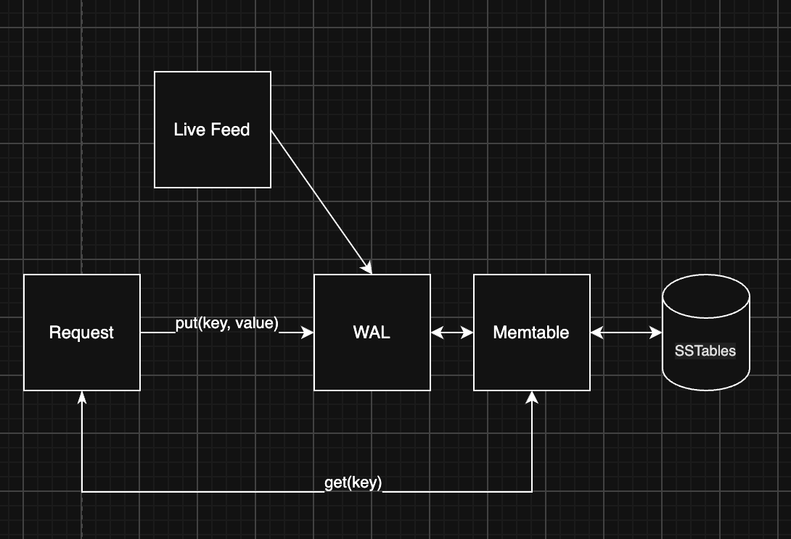

# lsm-kv Project Overview

<!-- Fill this in yourself. Keep it short: someone should understand the project in 2 minutes. -->
Build a LSM (log strucuted merge tree) in rust to handle heavy write applications such as live data ingestion to a live feed. 
Example pulling formula one car data such as throttle, brake, steering angle and etc and displaying it live 
This can be extended to personal sims as well allowing users to track and visualize their telemetry without paying for subscribition services.
This will alos be pairs with a follow up c++ query service that will query the data written from the LSM and drivers and see their past telemetry and compare against friends and compeitoris (whoever is willing to share data)  

Product decided Nov 16: a Windows app with lsm-kv embedded, the user's iRacing laps, real F1 laps fetched on demand, friends share by file. No server. See [PRODUCT.md](PRODUCT.md).

## What it is

<!-- One or two sentences: what lsm-kv is and what problem it solves. -->
A LSM KV solves the problem of heavy write applications.
This turns random writes into sequential writes, unlike a b tree that updates pages in place, a LSM will only append to a WAL and keep a sorted memtable in memory. When the memtable is full it gets flushed to disk as a sorted file (SSTable)

## Why I'm building it

<!-- What you want to learn or demonstrate. -->
I am building this to learn rust, learn more about rust as companies such as Discord and Dropbox use rust and those are target companies.
I am aiming for a mid level role and with my current data pipeline flow background. Working on a LSM KV tree could really round out my resume as a mid level data pipeline/workflow engineer 
Discord LSM based ScyllaDB with storage facing rust services  here: https://discord.com/blog/how-discord-stores-trillions-of-messages

## Data

<!-- Where the data comes from and how it reaches the store. -->
Current sources (Nov 16):
- Real F1: OpenF1, 2023 and later, free and no login. FastF1 needs a paid F1TV plan since Oct 2026, so it's out
- My driving: iRacing `.ibt` files, 60 Hz, read on the user's PC. See [IBT.md](IBT.md)
- Friends: session files they export and send

Original plan (the replay idea still applies to benchmarks, with OpenF1 instead of FastF1):
1. FastF1 data extracted through python scripts
2. Use replay to read exported Parquet files sorted by SessionTime.
    2_1. Emit each sample when its timestampe comes due by sleeping for a gap btween consective samples
    2_2. Add a speed multiplier to be able to feed the data in at 1x speed, 10x speed and nx speed to find the maximum preformance of our aplication with live data for benchmarks
    2_3. The ingest layer collects samples into a sector chunk and calls put when the sector ends, exactly as it would with live data.

## How it works (big picture)

<!-- The write path and read path in a few lines. A small ASCII diagram is fine. -->

Request will first check the memtable, if not found in memtable we will check the DB for the request
- Get 
    - Check the active memtable to see if key exist
    - Check the memtable being flushed
    - Check SSTables newest to oldest
        - Check against bloom filter to see if this exist in SSTables
    - if not found or TOMBSTONE return OK(None)
For the live feed, we will feed it to the WAL. 

- Write: 
    - user uses put(key, value) -> write operation to WAL
                                fsync
                                -> write to memtable
                                <- return success write
                                -> check memtable threshold against capacity
                                    -> if threshold >= capacity 
                                        -> start background Flush job 
The user can request the live feed but for now that is out of scope

## Code layout

Cargo workspace, two crates (split Nov 18):

| Crate | What's in it | Knows about racing? |
|---|---|---|
| `crates/lsm-kv` | The database: WAL, memtables, SSTables, manifest, merge iterator, store, bulk load. Benchmarks, config profiles | No: bytes in, bytes out |
| `crates/racedata` | Sources (`.ibt`, later OpenF1), laps and sectors, the track table, column chunks, keys, import into the store. Local `.ibt` / OpenF1 files in `data/` (git ignored) | Yes. Depends on `lsm-kv` |

- The UI (not started) sits on top of `racedata`. Its language is still open ([PRODUCT.md](PRODUCT.md))
- `lsm-kv` never depends on `racedata`

## Components

| Component | One-line summary | Status | Doc |
|---|---|---|---|
| WAL | Append-only log on disk, every put/delete is written + fsynced here first so the memtable can be rebuilt after a crash | Done for v1: encode, decode, append + fsync, replay, sequence numbers (34 tests). One segment per memtable | [WAL.md](WAL.md) |
| Memtable | Sorted in-memory map of recent writes (values and tombstones) | Done: BTreeMap memtable with seqs (14 tests), frozen queue + background flush in the Store | [MEMTABLE.md](MEMTABLE.md) |
| SSTable | Immutable sorted file on disk: data blocks, index, bloom filter, footer | Done: writer + reader, prefix compression, block CRCs, tmp + rename, `range` (41 tests). Used by the Store for flush and reads | [SSTABLE.md](SSTABLE.md) |
| Bloom filter | Per-SSTable bit array that says "definitely not here" to skip disk reads | Done: 6 bits/key, stable hash, own CRC | [BLOOM_FILTER.md](BLOOM_FILTER.md) |
| Flush | Writes a full memtable to a new SSTable | Done: four steps on a background thread, retries with growing wait, backpressure, crash tested at each step | [FLUSH.md](FLUSH.md) |
| Product | Windows app, lsm-kv embedded, iRacing + OpenF1 data, sharing by file | Decided (Nov 16) | [PRODUCT.md](PRODUCT.md) |
| .ibt reader | Reads iRacing telemetry files, keeps only the user's car, splits laps, times laps and sectors | Reader done (Nov 17): lap times match iRacing to 0.5 ms. Chunks + import next | [IBT.md](IBT.md) |
| Tracks | Which tracks match across sources, official F1 sector lines | Spa + Red Bull Ring (Nov 17) | [TRACKS.md](TRACKS.md) |
| Column chunks | The value format: samples as columns, self describing, channel catalog | Done (Nov 17): 15 tests | [CHUNK.md](CHUNK.md) |
| Bulk load | Loads a finished session straight into SSTables, one seq, all or nothing, refuses overlaps | Done (PR 4e): 19 tests, ~25x faster than puts in the container | [BULK_LOAD.md](BULK_LOAD.md) |
| Merge iterator | Reads memtables + SSTables as one sorted stream, newest seq per key, checks its inputs are sorted | Done (PR 4b): heap merge, data contract checks, benchmark (11 tests) | [MERGE.md](MERGE.md) |
| Compaction | Merges SSTables, keeps the newest version of each key | Designed (Nov 16): leveled, output split by namespace + session, own thread. Core in PR 4c | [COMPACTION.md](COMPACTION.md) |
| Manifest | List of live SSTables and the current WAL, the source of truth on startup | Done: whole-file rewrite with CRC, tmp + rename, file naming, obsolete files (29 tests). Used by the Store | [MANIFEST.md](MANIFEST.md) |
| Concurrency | Lock design for the background flush: three locks, lock order, 10 rules to avoid deadlock | Done: built and tested, deadlock test checked to fail when a rule is broken | [CONCURRENCY.md](CONCURRENCY.md) |
| Crash recovery | Rebuilds state on startup from the manifest + WAL replay | Done for 3a: manifest, cleanup, SSTables, segment replay, tested at every flush step. kill -9 tests in week 5 | [RECOVERY.md](RECOVERY.md) |
| Benchmarks | Microbenchmarks now, F1 replay and YCSB-style workloads later | In progress: CRC-32, fsync + group commit + `Store::put`, memtable get, full-size SSTable as criterion benches, run on Mac and in the Linux dev container. Real-hardware Linux fsync still to do | [BENCHMARKS.md](BENCHMARKS.md) |
| Development | Linux dev container: Docker + VS Code Dev Containers, every cargo command runs in it | Done (Nov 16) | [DEVELOPMENT.md](DEVELOPMENT.md) |
| Config | Tuning settings in TOML (`crates/lsm-kv/config/*.toml`), format constants stay in code | Done for memtable + SSTable settings (11 tests) | [CONFIG.md](CONFIG.md) |
| Store | Public API: open (replay), put / delete (WAL then memtable), get, scan | Done for v1 writes + reads: WAL segments, manifest, background flush, get across memtables + SSTables, shareable across threads, close, scan (49 tests) | [STORE.md](STORE.md) |

<!-- Status ideas: Not started / Designing / In progress / Done / Tested / Benchmarked -->

## Current status

<!-- Where the project is today, and what's next. -->
- Done
    - WAL record format: encode + decode with CRC-32, size limits, torn tail and corruption detection
    - WalWriter: append + fsync every write, failed state after a write or fsync error
    - WAL replay: decodes records in order, truncates a torn tail, reports corruption with the file offset
    - Memtable: BTreeMap of key -> Op, Lookup enum (Found / Deleted / NotFound), running size counter, sorted iter and range
    - Config: TOML tuning settings (memtable flush threshold, max frozen memtables), default + 16/64 MiB benchmark profiles
    - Store: open (replay, then WAL writer), put / delete (WAL first, then memtable), get from the memtable
    - SSTable: writer + reader with prefix-compressed 16 KiB blocks, last-key index, bloom filter, 22-byte footer, CRC on every section, tmp + rename
    - Sequence numbers: every write gets a u64 seq, stored in the WAL, the memtable, and every SSTable entry
    - Manifest: live WAL segments + SSTables (seq and key ranges), next file number, last seq, CRC, atomic save, finds obsolete files
    - Store on disk (PR 3a): WAL segments, flush to SSTables, get across every layer, crash recovery at each flush step, StoreError enum
    - Background flush + Store shareable across threads (PR 3b): three locks, backpressure, retries, close, concurrency tests under timeouts
    - Benchmarks as criterion benches (fsync, group commit, full SSTable, merge), Linux dev container, Linux x86 runs on GitHub Actions
    - Compaction designed: leveled, split by namespace + session, own thread, bulk load for historical sessions
    - Merge iterator + `SstReader::range` (PR 4b)
    - Bulk load (PR 4e, built before compaction): `begin_ingest` / `put` / `commit`
    - Column chunk value format + channel catalog (`crates/racedata/src/chunk.rs`)
    - `.ibt` reader, track table with official F1 sector lines
    - Workspace split: `crates/lsm-kv` (the database) and `crates/racedata` (everything about racing)
    - `Store::scan(start, end)`: newest value per key across every layer, tombstones hidden, SSTables outside the range skipped
    - 244 unit tests, CI on Linux and macOS
    - Benchmarks on Mac: crc32fast is 3-4x faster than crc32c, fsync is ~99.9% of a put (~3 ms, ~350 appends/s), memtable get allocation costs nothing measurable (copy ~0.2 us per 2 KB), a full 32 MiB SSTable flush takes ~40 ms, bloom makes missing-key gets ~9x faster
- Next ([ROADMAP.md](ROADMAP.md))
    - `.ibt` import: chunks, keys, session metadata, bulk load
    - OpenF1 fetch, lap processing (Python prototype first), UI
    - Later: export, Windows support, compaction core (4c) and thread (4d)

## Milestones

Revised 2026-11-13: background flush pulls WAL segments and the manifest into week 3, and the ingest layer gets its own slot in week 6.

| Week | Dates | Goal | Done? |
|---|---|---|---|
| 0 | Nov 3-9 | Rust basics, repo, CI, design doc | Done |
| 1 | Nov 10-16 | WAL + replay, memtable, store (open / put / delete / get) | Done |
| 2 | Nov 17-23 | SSTable writer + reader: data blocks, index, footer, block CRC, point lookup, bloom filters | Done (Nov 13) |
| 3 | Nov 24-30 | Sequence numbers, minimal manifest, background flush, frozen memtable queue, WAL segments, read path across memtables + SSTables, Store shareable across threads | Done (Nov 13) |
| 4 | Dec 1-7 | Compaction (leveled), merge iterator, atomic swap through the manifest, dropping tombstones, bulk load | In progress: benchmarks, design, merge iterator, bulk load done (Nov 16) |
| 5 | Dec 8-14 | Scan (on the merge iterator from 4b), crash tests (kill -9), property tests, recovery cleanup | Scan done early (Nov 22) |
| 6 | Dec 15-21 | Ingest (FastF1 -> Parquet -> keys / values), benchmarks on Linux, group commit, RocksDB / sled comparison, README | |

## Full design

See [DESIGN.md](DESIGN.md).
