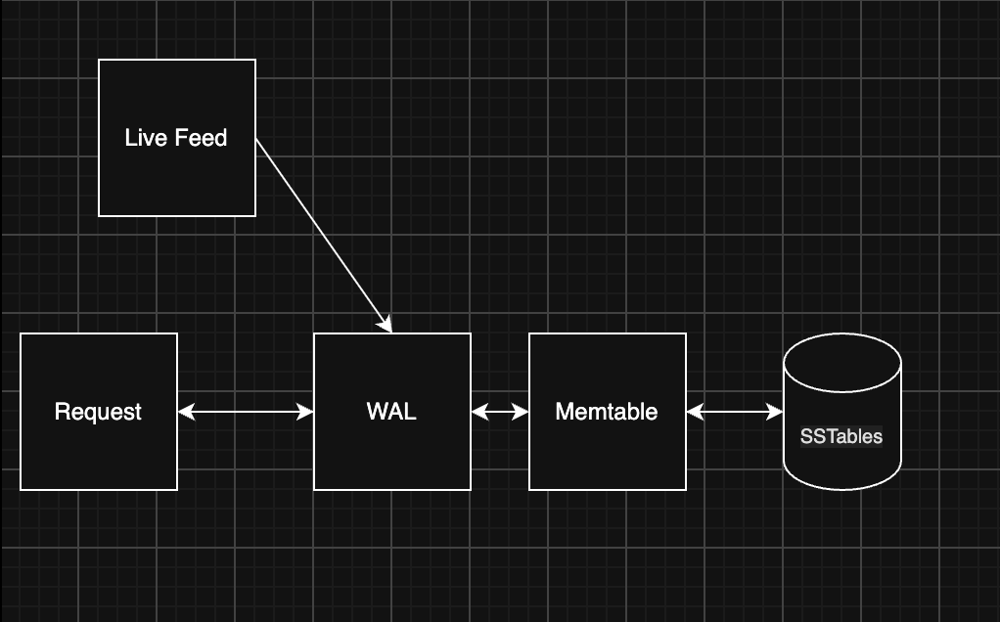

# lsm-kv Project Overview

<!-- Fill this in yourself. Keep it short: someone should understand the project in 2 minutes. -->
Build a LSM (log strucuted merge tree) in rust to handle heavy write applications such as live data ingestion to a live feed. 
Example pulling formula one car data such as throttle, brake, steering angle and etc and displaying it live 
This can be extended to personal sims as well allowing users to track and visualize their telemetry without paying for subscribition services.
This will alos be pairs with a follow up c++ query service that will query the data written from the LSM and drivers and see their past telemetry and compare against friends and compeitoris (whoever is willing to share data)  

## What it is

<!-- One or two sentences: what lsm-kv is and what problem it solves. -->
A LSM KV solves the problem of heavy write applications.
This turns random writes into sequential writes, unlike a b tree that updates pages in place, a LSM will only write to a WAL that then writes the writes in sorted order

## Why I'm building it

<!-- What you want to learn or demonstrate. -->
I am building this to learn rust, learn more about rust as companies such as Discord and Dropbox use rust and those are target companies.
I am aiming for a mid level role and with my current data pipeline flow background. Working on a LSM KV tree could really round out my resume as a mid level data pipeline/workflow engineer 
Discord LSM based ScyllaDB with storage facing rust services  here: https://discord.com/blog/how-discord-stores-trillions-of-messages

## Data

<!-- Where the data comes from and how it reaches the store. -->
1. FastF1 data extracted through python scripts
2. Use replay to read exported Parquet files sorted by SessionTime.
    2_1. Emit each sample when its timestampe comes due by sleeping for a gap btween consective samples
    2_2. Add a speed multiplier to be able to feed the data in at 1x speed, 10x speed and nx speed to find the maximum preformance of our aplication with live data for benchmarks
    2_3. The ingest layer collects samples into a sector chunk and calls put when the sector ends, exactly as it would with live data.

## How it works (big picture)

<!-- The write path and read path in a few lines. A small ASCII diagram is fine. -->

Request will first check the memtable, if not found in memtable we will check the DB for the request
- Get 
    - Check the active memtable to see if key exist
    - Check the memtable being flushed
    - Check SSTables newest to oldest
        - Check against bloom filter to see if this exist in SSTables
    - if not found or TOMBSTONE return OK(None)
For the live feed, we will feed it to the WAL. 

- Write: 
    - user uses put(key, value) -> write operation to WAL
                                fsync
                                -> write to memtable
                                <- return success write
                                -> check memtable threshold against capacity
                                    -> if threshold >= capacity 
                                        -> start background Flush job 
The user can request the live feed but for now that is out of scope

## Components

| Component | One-line summary | Status | Doc |
|---|---|---|---|
| WAL | | | [WAL.md](WAL.md) |
| Memtable | | | [MEMTABLE.md](MEMTABLE.md) |
| SSTable | | | [SSTABLE.md](SSTABLE.md) |
| Bloom filter | | | [BLOOM_FILTER.md](BLOOM_FILTER.md) |
| Flush | | | [FLUSH.md](FLUSH.md) |
| Compaction | | | [COMPACTION.md](COMPACTION.md) |
| Manifest | | | [MANIFEST.md](MANIFEST.md) |
| Crash recovery | | | [RECOVERY.md](RECOVERY.md) |
| Benchmarks | | | [BENCHMARKS.md](BENCHMARKS.md) |

<!-- Status ideas: Not started / Designing / In progress / Done / Tested / Benchmarked -->

## Current status

<!-- Where the project is today, and what's next. -->

## Milestones

| Week | Goal | Done? |
|---|---|---|
| 0 | | |
| 1 | | |
| 2 | | |
| 3 | | |
| 4 | | |
| 5 | | |
| 6 | | |

## Full design

See [DESIGN.md](DESIGN.md).
